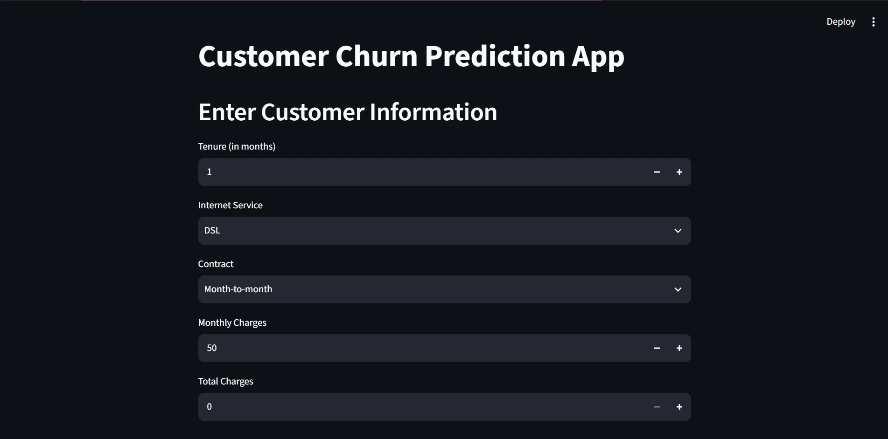

# Customer Churn Prediction

A Streamlit demo that uses a Random Forest classifier to predict telecom customer churn from tenure, internet service, contract type, and monthly and total charges. The prediction updates when you change an input.



## Run locally

Use Python 3.12 in a virtual environment.

```sh
python -m pip install -r requirements.txt
python -m streamlit run churn_app.py
```

The repository includes the trained model. To train another model, place a compatible `Telco_Customer_Churn.csv` beside `churn_main.py` and run `python churn_main.py`. The CSV needs the columns `tenure`, `InternetService`, `Contract`, `MonthlyCharges`, `TotalCharges`, and `Churn`.

The training script fits the model on all supplied rows. Evaluate it on separate data before using its predictions in a real workflow.
